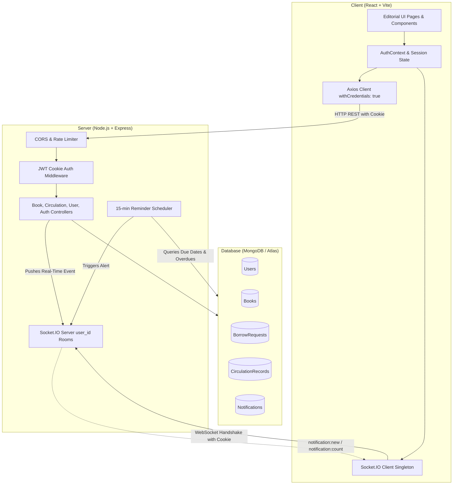
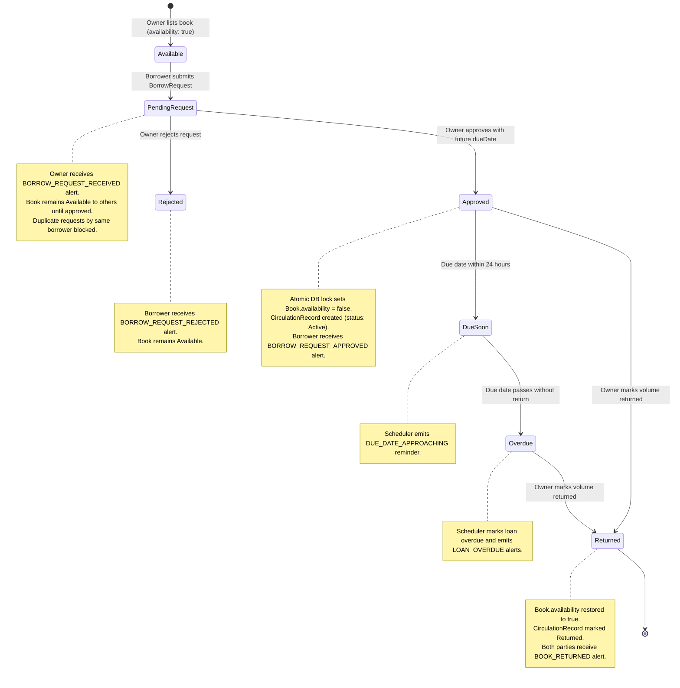

# BookLoop — Community Book Circulation Platform

BookLoop is a full-stack MERN application designed for community-driven book sharing, lending, and circulation tracking. It replaces informal or disorganized book lending with structured borrowing lifecycles, automated loan reminders, real-time push notifications, and clear multi-user ownership authorization.

Built with an editorial aesthetic, BookLoop combines the tactile warmth of traditional library ledger books with real-time web capabilities.

---

## 1. Project Overview

Physical books frequently sit idle on home shelves after a single reading. Meanwhile, community book sharing between friends, neighbors, or book clubs often suffers from:
- Forgotten loans and lost volumes.
- Lack of clear return due dates.
- Ambiguous ownership records.
- Friction in tracking who is currently reading what.

BookLoop provides an online community library ledger where readers catalog their personal collections, discover volumes shared by peers, submit borrowing requests, agree on loan terms and return dates, and receive automated reminders before due dates elapse.

---

## 2. Key Features

- **Public & Curated Catalogue**: Browse shared volumes with instant search across titles and authors, plus filtering by 20+ genres.
- **Open Library Metadata & Covers Integration**: Real-time bibliographic lookup by title or ISBN using the non-commercial Open Library and Covers APIs with polite throttling and in-memory caching—no API keys or commercial quotas required.
- **Persistent User Accounts**: Secure user registration, credential validation, bcrypt password hashing, and HTTP-only session cookie management.
- **Ownership Authorization**: Strict multi-tenant authorization where only volume owners can modify/delete listings or approve/reject loan requests.
- **Concurrency-Safe Borrowing Lifecycle**: Atomic lock guards prevent double-loaning when concurrent requests occur.
- **Independent Circulation Ledger**: Persistent `CirculationRecord` historical ledger independent of request lifecycle, calculating real-time overdue statuses.
- **Live Notifications via Socket.IO**: Real-time push updates delivering alerts for borrow requests, approvals, declines, upcoming due dates, overdues, and completed returns.
- **Automated Reminder Scheduler**: Scheduled background engine running every 15 minutes to trigger 24-hour approaching due date alerts and overdue warnings with database-level deduplication.
- **Reader Dashboard & Profile**: Metrics dashboard tracking volumes listed, active loans, pending approvals, active borrowings, and completed exchanges, alongside editable member profile information.
- **Strict Editorial Design System**: Bespoke visual design employing the approved BookLoop palette (`#233E78`, `#788451`, `#F7F7F0`, `#171717`, `#FFFFFF`) and typography (`Newsreader` serif headings + `DM Sans` interface).

---

## 3. Technology Stack

| Tier | Technologies |
| :--- | :--- |
| **Frontend** | React 18, Vite 5, React Router v6, Axios, Socket.IO Client, CSS3 Custom Properties |
| **Backend** | Node.js (LTS), Express 4, Socket.IO, Cookie Parser, CORS, Dotenv |
| **Database** | MongoDB, Mongoose 8 ODM (`mongodb-memory-server` automatic fallback for zero-config local dev) |
| **External APIs** | Open Library Search API & Covers API (Zero API keys, community-backed) |
| **Security & Auth** | JWT (JSON Web Tokens), Bcrypt.js (10 salt rounds), HTTP-only cookies, Regex escaping, In-memory rate limiting |
| **Deployment Targets**| Vercel (Frontend SPA), Render (Backend Web Service), MongoDB Atlas (Cloud Database) |

---

## 4. Architecture Overview



---

## 5. The Borrowing Lifecycle

Every book exchange follows a structured state machine:



1. **Request Submission**: Borrower selects a book and submits a request. The owner is notified in real time. The book remains visible and available to other potential borrowers while the request is pending.
2. **Approval & Concurrency Lock**: The owner specifies a return due date and approves. BookLoop executes an atomic update (`findOneAndUpdate({ _id, availability: true }, { availability: false })`). If another loan was approved concurrently, the second approval is rejected with HTTP 409 Conflict.
3. **Circulation Tracking**: An independent immutable `CirculationRecord` is created documenting the loan agreement.
4. **Reminders & Overdue Detection**: The background scheduler runs every 15 minutes. Borrowers receive reminders 24 hours prior to due dates. If unreturned past the due date, both parties receive overdue notifications with dynamically computed overdue day tallies.
5. **Return Confirmation**: When the borrower returns the volume, the owner marks it as returned. BookLoop marks the request and circulation record as `Returned`, restores book availability to `true`, and notifies both participants.

---

## 6. Project Folder Structure

```text
BookLoop/
├── .env.example                     # Comprehensive environment variable template
├── .gitignore                       # Git exclusions for dependencies, build artifacts, env
├── README.md                        # Complete project documentation
├── client/                          # React + Vite Frontend
│   ├── .env.example                 # Frontend Vite environment template
│   ├── vercel.json                  # Vercel SPA routing and rewrites configuration
│   ├── package.json                 # Client dependencies & build scripts
│   ├── vite.config.js               # Vite config with /api and /socket.io dev proxy
│   ├── index.html                   # HTML entry point with Newsreader & DM Sans fonts
│   └── src/
│       ├── App.jsx                  # Root routes & protected route gates
│       ├── main.jsx                 # React root mount
│       ├── components/              # Reusable UI components
│       │   ├── BookCard.jsx         # Book display card with image fallback
│       │   ├── EmptyState.jsx       # Editorial empty state illustration
│       │   ├── ErrorState.jsx       # Standardized error panel
│       │   ├── Footer.jsx           # Editorial site footer
│       │   ├── GenreFilter.jsx      # Genre selection pills
│       │   ├── Loader.jsx           # Literary minimal spinner
│       │   ├── Navbar.jsx           # Navigation header with unread badge
│       │   ├── NotificationBell.jsx # Live bell dropdown with real-time count
│       │   ├── ProtectedRoute.jsx   # Route guard redirecting to /login
│       │   └── SearchBar.jsx        # Search input with clear button
│       ├── context/
│       │   └── AuthContext.jsx      # Authentication session & Socket.IO listener state
│       ├── layouts/
│       │   └── MainLayout.jsx       # Top navbar + main container + footer layout
│       ├── pages/
│       │   ├── AddBookPage.jsx      # Book contribution form with validation
│       │   ├── BookDetailsPage.jsx  # Volume view, owner controls, & borrow request form
│       │   ├── BorrowingsPage.jsx   # Reader's outgoing requests and active loans
│       │   ├── CirculationPage.jsx  # Community ledger & loan history
│       │   ├── DashboardPage.jsx    # Live metrics, active loans, and quick actions
│       │   ├── ExploreBooksPage.jsx # Searchable catalogue with genre filters
│       │   ├── HomePage.jsx         # Hero introduction and community metrics
│       │   ├── LendingPage.jsx      # Owner incoming request review & loan return management
│       │   ├── LoginPage.jsx        # Member sign-in with error validation
│       │   ├── NotificationsPage.jsx# Paginated notifications with All / Unread tabs
│       │   ├── ProfilePage.jsx      # Member tenure, circulation stats, & name edit
│       │   └── RegisterPage.jsx     # Member account registration
│       ├── services/
│       │   ├── api.js               # Axios instance with environment-aware baseURL
│       │   ├── authService.js       # Register, login, logout, getMe API calls
│       │   ├── bookService.js       # Book CRUD and stats API calls
│       │   ├── circulationService.js# Borrow requests and returns API calls
│       │   ├── notificationService.js# Notification pagination and read API calls
│       │   ├── socket.js            # Socket.IO client singleton
│       │   └── userService.js       # Profile and dashboard stats API calls
│       └── styles/
│           ├── global.css           # Global typography, reset, and button classes
│           └── variables.css        # Strict BookLoop design tokens
└── server/                          # Express + Node.js Backend
    ├── .env                         # Server local environment variables
    ├── .env.example                 # Server environment template
    ├── package.json                 # Server dependencies & scripts
    ├── server.js                    # Express app, HTTP server, & Socket.IO initialization
    ├── config/
    │   └── db.js                    # MongoDB connection with memory-server dev fallback
    ├── controllers/
    │   ├── authController.js        # Auth registration, login, logout, cookie dispatch
    │   ├── bookController.js        # Catalog search, creation, updates, ReDoS-safe delete
    │   ├── circulationController.js # Request creation, atomic approval, rejection, returns
    │   ├── notificationController.js# User-isolated notification queries & read updates
    │   └── userController.js        # Profile metrics aggregation & name updates
    ├── middleware/
    │   ├── auth.js                  # authenticateUser and requireAuth middleware
    │   ├── errorHandler.js          # Centralized error handler with production masking
    │   ├── rateLimiter.js           # In-memory auth rate limiting
    │   └── validateBook.js          # Book payload validation
    ├── models/
    │   ├── Book.js                  # Book schema, text search index, genre enum
    │   ├── BorrowRequest.js         # BorrowRequest schema with status & user indexes
    │   ├── CirculationRecord.js     # Circulation ledger schema with overdue indexes
    │   ├── Notification.js          # Notification schema with deduplication indexes
    │   └── User.js                  # User schema with bcrypt pre-save hook
    ├── routes/
    │   ├── authRoutes.js            # /api/auth endpoints
    │   ├── bookRoutes.js            # /api/books endpoints
    │   ├── circulationRoutes.js     # /api/borrow-requests and /api/circulation endpoints
    │   ├── notificationRoutes.js    # /api/notifications endpoints
    │   └── userRoutes.js            # /api/users endpoints
    ├── scripts/
    │   ├── backupGuide.md           # Database backup and disaster recovery instructions
    │   ├── migratePhase2_5.js       # Data migration script for Phase 2.5
    │   ├── migratePhase3.js         # Data migration script for Phase 3 users
    │   ├── seedDevUsers.js          # Seed Alice and Bob demo accounts
    │   ├── testPhase3.js            # Phase 3 authentication test suite (25 tests)
    │   ├── testPhase4.js            # Phase 4 notifications & UX test suite (14 tests)
    │   └── testPhase5.js            # Phase 5 security & verification test suite (15 tests)
    └── services/
        ├── notificationService.js   # Persistence-first notification creation & socket push
        ├── reminderScheduler.js     # 15-minute cron runner with MongoDB deduplication
        └── socketService.js         # Socket.IO room management & handshake auth
```

---

## 7. Database Models Summary

| Model | Key Fields | Indexes | Description |
| :--- | :--- | :--- | :--- |
| **`User`** | `name`, `email`, `password`, `role`, `isClaimed` | `email` (unique) | Authenticated user account with bcrypt password hashing (salt 10) and `select: false`. |
| **`Book`** | `title`, `author`, `genre`, `description`, `coverImage`, `ownerId`, `ownerName`, `availability` | `{ title: 'text', author: 'text' }`, `genre: 1`, `availability: 1`, `ownerId: 1` | Catalog volume listing with ownership attribution. |
| **`BorrowRequest`** | `bookId`, `borrowerId`, `borrowerName`, `ownerId`, `ownerName`, `status`, `notes`, `dueDate`, `approvedAt`, `returnedAt` | `{ ownerId: 1, status: 1 }`, `{ borrowerId: 1, status: 1 }`, `{ bookId: 1, borrowerId: 1, status: 1 }` | State-driven borrowing request record. |
| **`CirculationRecord`** | `borrowRequestId`, `bookId`, `bookTitle`, `bookAuthor`, `borrowerId`, `borrowerName`, `ownerId`, `ownerName`, `borrowedDate`, `dueDate`, `returnedDate`, `status` | `{ status: 1, dueDate: 1 }`, `{ ownerId: 1, status: 1 }`, `{ borrowerId: 1, status: 1 }` | Independent historical ledger of completed and active circulation loans. |
| **`Notification`** | `userId`, `type`, `title`, `message`, `relatedBookId`, `relatedRequestId`, `isRead`, `readAt` | `{ userId: 1, createdAt: -1 }`, `{ userId: 1, isRead: 1 }`, `{ relatedRequestId: 1, type: 1 }` | User-isolated persistent notifications. |

---

## 8. API Endpoint Reference

### Authentication (`/api/auth`)
| Method | Endpoint | Access | Description |
| :--- | :--- | :--- | :--- |
| `POST` | `/api/auth/register` | Public (Rate-limited) | Register a new user account and set HTTP-only cookie |
| `POST` | `/api/auth/login` | Public (Rate-limited) | Sign in with email and password, setting session cookie |
| `POST` | `/api/auth/logout` | Authenticated | Clear session cookie and invalidate session |
| `GET` | `/api/auth/me` | Authenticated | Retrieve authenticated user profile |

### Books Catalog (`/api/books`)
| Method | Endpoint | Access | Description |
| :--- | :--- | :--- | :--- |
| `GET` | `/api/books` | Public | List books with search query, genre filter, and availability |
| `GET` | `/api/books/stats` | Public | Total, available, and borrowed counts |
| `GET` | `/api/books/:id` | Public | Retrieve single book details |
| `POST` | `/api/books` | Authenticated | Add a new book attributed to authenticated user |
| `PATCH`| `/api/books/:id` | Owner Only | Update title, author, genre, description, or image |
| `DELETE`| `/api/books/:id` | Owner Only | Delete book (blocked if currently on loan) |

### Circulation & Borrowing (`/api`)
| Method | Endpoint | Access | Description |
| :--- | :--- | :--- | :--- |
| `POST` | `/api/borrow-requests` | Authenticated | Submit request (blocked if own book, unavailable, or duplicate) |
| `GET` | `/api/borrow-requests` | Public / Filtered | List requests with filters (`ownerId`, `borrowerId`, `status`) |
| `GET` | `/api/borrow-requests/:id` | Public | Retrieve single borrow request details |
| `PATCH`| `/api/borrow-requests/:id/approve` | Owner Only | Approve request with future due date (atomic lock) |
| `PATCH`| `/api/borrow-requests/:id/reject` | Owner Only | Decline pending request |
| `PATCH`| `/api/borrow-requests/:id/return` | Owner Only | Mark book returned, restoring availability |
| `GET` | `/api/circulation` | Public / Filtered | Circulation history ledger with dynamic overdue calculation |
| `GET` | `/api/circulation/overdue` | Public | List currently overdue loans |

### Notifications (`/api/notifications`)
| Method | Endpoint | Access | Description |
| :--- | :--- | :--- | :--- |
| `GET` | `/api/notifications` | Authenticated | Paginated notifications with optional `unreadOnly=true` |
| `GET` | `/api/notifications/count` | Authenticated | Returns `{ unreadCount, pendingLendingRequests }` |
| `PATCH`| `/api/notifications/:id/read` | Recipient Only | Mark single notification as read |
| `PATCH`| `/api/notifications/read-all` | Authenticated | Bulk mark all notifications as read |

### User Profile & Dashboard (`/api/users`)
| Method | Endpoint | Access | Description |
| :--- | :--- | :--- | :--- |
| `GET` | `/api/users/profile` | Authenticated | Profile details, member tenure, and circulation summary |
| `PATCH`| `/api/users/profile` | Authenticated | Update display name safely |
| `GET` | `/api/users/dashboard-stats` | Authenticated | Live dashboard metrics (books, active loans, returns) |

---

## 9. Local Installation & Setup

### Prerequisites
- Node.js 18+ LTS
- npm 9+
- Optional: Local MongoDB on port 27017 (If absent, BookLoop starts an automatic in-memory MongoDB database).

### Step-by-Step Installation

```bash
# 1. Clone repository
git clone https://github.com/your-username/bookloop.git
cd BookLoop

# 2. Install Server Dependencies
cd server
npm install

# 3. Configure Server Environment
cp .env.example .env

# 4. Install Client Dependencies
cd ../client
npm install
```

---

## 10. Running the Application Locally

### Starting Backend Server

```bash
cd server
npm run dev
# Or: node server.js
```
The server will initialize on port 5000:
- If a local MongoDB instance is running at `mongodb://localhost:27017/bookloop`, it connects immediately.
- If no local MongoDB is detected, `mongodb-memory-server` spins up automatically, seeds demo accounts (Alice & Bob), and runs migrations.

### Starting Frontend Client

```bash
cd client
npm run dev
```
The Vite development server starts at `http://localhost:5173`. Requests to `/api` and `/socket.io` are automatically proxied to the backend on port 5000.

### Pre-Seeded Demo Accounts (Development Only)
For local development and testing (`NODE_ENV !== 'production'`), demo accounts are seeded automatically if absent:
- **Alice**: `alice@bookloop.local` (Development only)
- **Bob**: `bob@bookloop.local` (Development only)

*Note: Demo account seeding is disabled in production environments.*

---

## 11. Automated Testing

BookLoop includes automated end-to-end and regression test suites covering 100% of the platform's core workflows:

```bash
# In the server/ directory:

# Run Phase 5 Security & Verification Suite (15 tests)
node scripts/testPhase5.js

# Run Phase 4 Notifications & Reminder Scheduler Suite (14 tests)
node scripts/testPhase4.js

# Run Phase 3 Authentication & Ownership Regression Suite (25 tests)
node scripts/testPhase3.js
```

### Building Frontend for Production

```bash
cd client
npm run build
```
Generates an optimized SPA bundle in `client/dist/` with zero TypeScript or bundling errors.

---

## 12. Production Deployment Instructions

### Database: MongoDB Atlas
1. Create a free M0 cluster at [mongodb.com/atlas](https://www.mongodb.com/atlas).
2. Under **Database Access**, create a user with read/write privileges.
3. Under **Network Access**, add IP address `0.0.0.0/0` (allow access from anywhere) to allow connection from Render.
4. Copy the connection string (`mongodb+srv://<user>:<password>@cluster.mongodb.net/bookloop?retryWrites=true&w=majority`).

### Backend: Render
1. Create a new **Web Service** on [render.com](https://render.com).
2. Connect the Git repository and select the root directory as `server`.
3. Set **Build Command**: `npm install`
4. Set **Start Command**: `node server.js`
5. Configure Environment Variables in Render:
   - `NODE_ENV`: `production`
   - `PORT`: `10000` (Render defaults to 10000)
   - `MONGODB_URI`: `<Your MongoDB Atlas connection string>`
   - `CLIENT_URL`: `https://your-bookloop-client.vercel.app`
   - `JWT_SECRET`: `<Generate a 64-char random hex string>`
   - `JWT_EXPIRES_IN`: `7d`
   - `COOKIE_SAME_SITE`: `none`

### Frontend: Vercel
1. Create a new project on [vercel.com](https://vercel.com).
2. Select the repository and set the **Root Directory** to `client`.
3. Framework Preset: **Vite**.
4. Configure Environment Variables in Vercel:
   - `VITE_API_URL`: `https://your-bookloop-api.onrender.com/api`
   - `VITE_SERVER_URL`: `https://your-bookloop-api.onrender.com`
5. Deploy. Vercel utilizes `vercel.json` to handle client-side routing rewrites.

---

## 13. Security Considerations & Protections

1. **HTTP-Only Session Cookies**: Session tokens are dispatched via `httpOnly: true` cookies, protecting credentials from browser JavaScript theft (XSS).
2. **Cross-Origin Cookie Security**: In production cross-site architectures (Vercel -> Render), cookies enforce `sameSite: 'none'` paired with `secure: true`.
3. **Password Protection**: Passwords are hashed using `bcryptjs` with 10 salt rounds. The field is configured with `select: false` so hashes are never returned by default in API queries.
4. **Brute Force Rate Limiting**: An in-memory rate-limiter protects `/api/auth/login` and `/api/auth/register` against high-frequency dictionary attacks.
5. **ReDoS Metacharacter Sanitization**: All user search inputs pass through regex escaping before query compilation, mitigating regular expression denial-of-service vulnerabilities.
6. **Loan Deletion Guard**: Books with active loans (`availability: false`) cannot be deleted, preventing orphaned loans and circulation records.
7. **Production Error Masking**: Internal server errors (HTTP 500) return a generic message in production to prevent stack trace or database credential exposure.
8. **In-Memory Guard in Production**: If `NODE_ENV === 'production'`, the server refuses to fall back to `MongoMemoryServer`, guaranteeing that cloud servers fail fast rather than saving data to ephemeral RAM.
9. **Mandatory Production JWT Secret**: When `NODE_ENV === 'production'`, `JWT_SECRET` is strictly required and must be at least 32 characters long. The application fails fast at startup if missing or weak. Fallback secrets and demo user seeding are strictly confined to local development.

---

## 14. Approved Design System

BookLoop strictly follows its approved editorial design system:

| Color | Hex Code | Purpose |
| :--- | :--- | :--- |
| **Royal Blue** | `#233E78` | Primary actions, buttons, active links, badges |
| **Olive** | `#788451` | Subtle decorative accents, tags |
| **Ivory** | `#F7F7F0` | Alternating section backgrounds, dropdowns |
| **Black** | `#171717` | High-contrast typography and borders |
| **White** | `#FFFFFF` | Primary canvas and book cards |

- **Headings**: `Newsreader`, Georgia, serif.
- **Interface**: `DM Sans`, -apple-system, sans-serif.
- **Buttons**: All buttons feature Royal Blue background with white text and a clean 2px border radius.
- **Restricted**: No beige, no brown, no unapproved accent colors.

---

## 15. License

MIT License. Designed and crafted for community book sharing.

